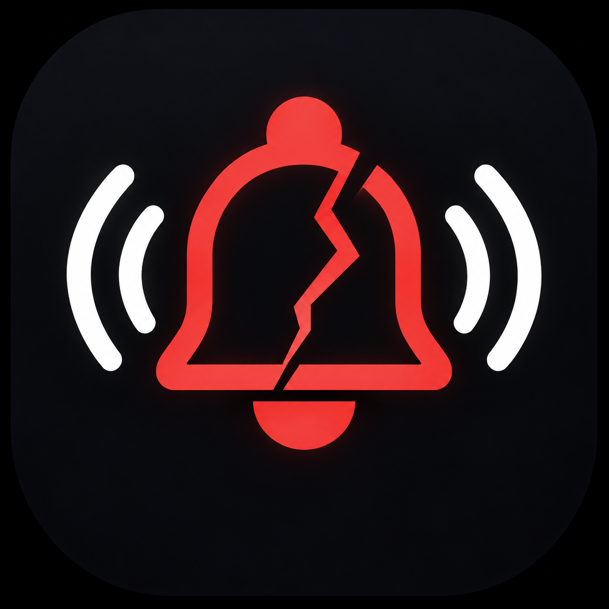

<p align="center">
  
</p>

<h1 align="center">FKO-Vib</h1>

<p align="center">
  <b>让 ColorOS 在振动模式下保留通知铃声的差异化触觉联动。</b>
</p>

<p align="center">
  
  
  
  
</p>

---

## 这是什么

ColorOS 在响铃模式下，不同的通知铃声会带来不同的振动节奏。切到振动模式后，这个差异会消失，所有通知都退化成同一种默认振动。

FKO-Vib 是一个轻量的 Xposed 模块，让振动模式重新使用系统原生的「铃声 → 振动」联动，同时保持完全无声。

它不生成自定义振动波形，也不修改音频输出，只是恢复系统内部本来就有的一条判定分支。

## 效果

- **振动模式**：通知没有声音，但振动跟随对应铃声；不同铃声振动不同。
- **响铃模式**：与原生完全一致。
- 不影响勿扰、通知渠道、应用通知设置，也不影响来电、闹钟、媒体和游戏振动。

> 想换一种振动效果，直接切换通知铃声即可。

## 原理

ColorOS 的振动联动依赖系统内部的一项「振动模式铃声触觉」支持判定。部分机型出厂没有声明这项支持，导致该判定永远为否，振动模式只能回退到默认振动。

模块只把这个判定恢复为「是」，让系统重新走它自己的原生播放路径：铃声照常播放，但可听音频被系统静音，触觉通道保留。

不介入音频数据，不伪造振动。

## 兼容性

| 项目 | 要求 |
|---|---|
| 系统 | ColorOS / OPlus，Android 15+ |
| 框架 | LSPosed 或兼容 Xposed API 93+ 的框架（如 Vector） |
| 作用域 | 仅「系统框架」（`android`，即 system_server） |
| Root | 需要（框架本身要求） |

如果设备本身已经支持该特性，模块通常不会产生效果，也不会破坏原生行为。

## 安装

1. 从 Releases 下载 `FKO-Vib-x.y.z.apk`。
2. 安装后，在 LSPosed / Vector 中启用模块。
3. 作用域只勾选「系统框架」（`android`），不要勾普通应用。
4. 重启设备，或软重启 system_server。
5. 验证模块已加载：

```bash
adb logcat -s FKOVib
# 期望看到：installed: ... -> true
```

## 验证效果

1. 切到振动模式。
2. 触发一条带通知铃声的通知。
3. 应当完全无声，但振动跟随铃声。
4. 换一个通知铃声再触发，振动应随之变化。
5. 切回响铃模式，确认声音与振动和原生一致。

## 禁用与卸载

- 在 LSPosed / Vector 中禁用模块并重启，即可恢复原生行为。
- 卸载 APK 不会留下系统改动，也无需恢复任何分区。

## 构建

需要：

- JDK 17+
- Android SDK build-tools（`aapt2`、`d8`、`apksigner`、`zipalign`）
- Android platform `android.jar`（API 35+）

```powershell
.\build.ps1 `
  -BuildTools "C:\Android\build-tools\36.0.0" `
  -AndroidJar "C:\Android\platforms\android-36\android.jar"
```

产物输出到 `dist/`。

> 当前 Release 使用本地自签名证书（调试 keystore），并非正式发布证书。

## 目录结构

```
FKO-Vib/
├─ module/               # 模块源码与清单
│  ├─ AndroidManifest.xml
│  ├─ assets/xposed_init
│  ├─ res/drawable/      # 模块图标
│  └─ src/               # Hook 实现
├─ libs/xposed-api.jar   # Xposed API
├─ build.ps1             # 无 Gradle 构建脚本
├─ FKOV.png              # 项目图标
├─ README.md
└─ LICENSE
```

## 风险与免责

- 这是系统级 Xposed 模块，作用域为 system_server。
- 模块只修改一个判定，并为所有注册与回调做了异常保护；失败时会自动回退原生行为。
- 不同 ColorOS 版本的系统实现可能变化，届时模块可能失效（日志中会显示安装失败）。
- 软重启 system_server 期间设备会短暂卡顿或黑屏，属正常现象。
- 使用本模块的风险由使用者自行承担。

## License

[MIT](LICENSE)
